# Практическая работа по Докеру

## Проверка докера
 - Docker Version
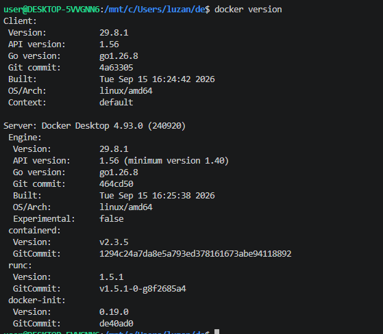

## Подготовка Docker
- Проверка, есть ли установленные контейнеры
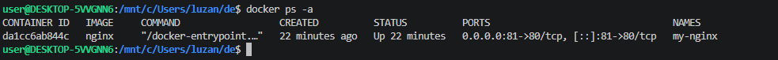
---
- останавливаем и удаляем ненужные контейнеры
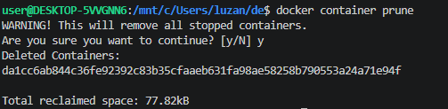
---
- Убеждаемся, что все контейнеры удалены
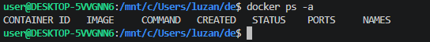

## Получение Готового образа Ngnix
- Нахождение нужного образа
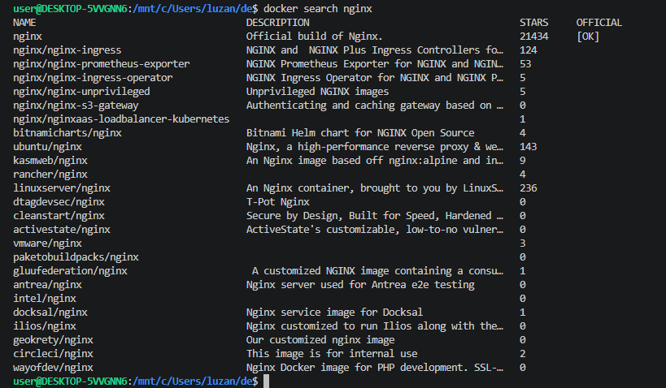
---
- Получение, создание и запуск Ngnix
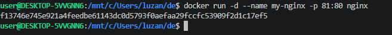
---
- Загруженный образ
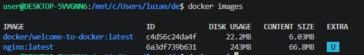
---
- Показ рабочего Ngnix
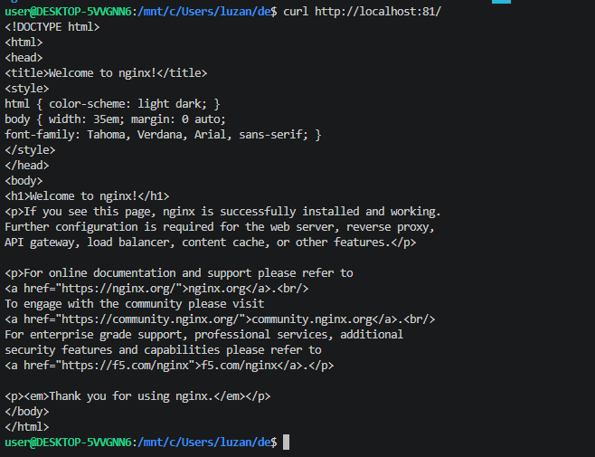
---
-  Получение информация по загруженному образу
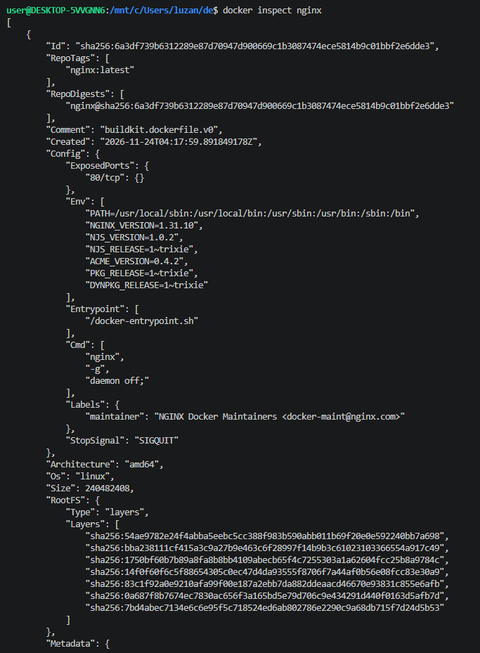
- Остановка контейнера:

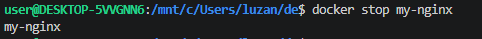

- Перезапуск контейнера по имени

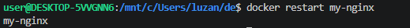

- Перезапуск контейнера по айди
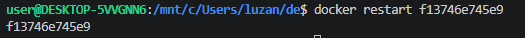

## Проверка работы контейнера
- Показ наличия загруженного файла образа
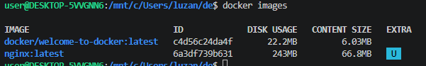
- Показ только запущенных контейнеров
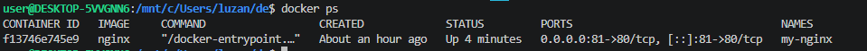
- Показ всех контейнеров
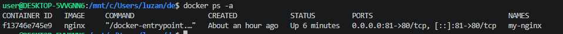
## Управление контейнером
#### Мониторинг контейнеров

